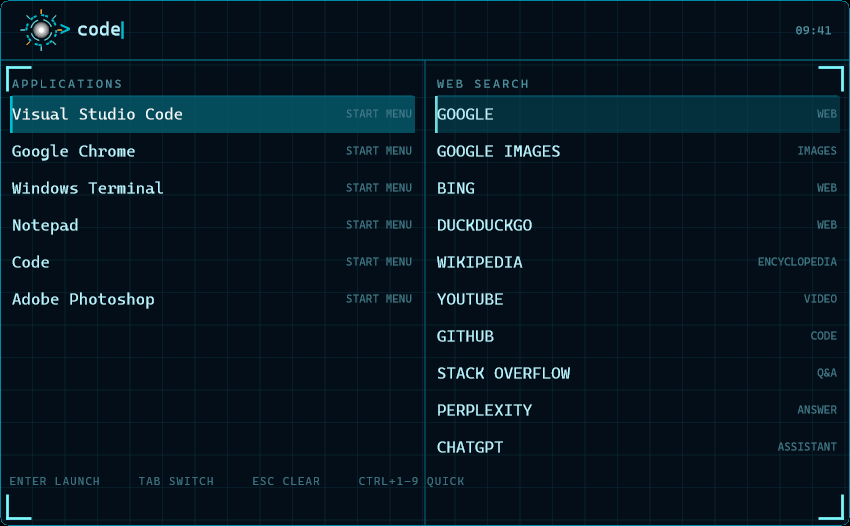

# JARVIS SEARCH

A JARVIS styled search bar that lives on your Windows desktop.

One bar, always there, that you bring up with a hotkey. Type into it and it
shows you two things at once:

* **left pane** — the applications that are installed on the machine,
* **right pane** — the web search providers.

Click an entry and it does the obvious thing: an application launches, a web
search opens in your browser.

Everything is drawn by hand. There is no web view, no browser engine, no
runtime, no dependency of any kind. It is one statically linked executable
that talks to the shell directly.



---

## Install

The repository ships a **ready to run `dist/` folder**, so the program can be
installed on a machine that has no compiler:

```powershell
powershell -ExecutionPolicy Bypass -File .\dist\install.ps1
```

That copies the program to `%LOCALAPPDATA%\JarvisSearch`, registers it under
`HKCU\Software\Microsoft\Windows\CurrentVersion\Run` so it starts with
Windows, writes a Start menu shortcut and starts it right away.

To undo it:

```powershell
powershell -ExecutionPolicy Bypass -File .\dist\uninstall.ps1
```

The executable can also register itself:

```
JarvisSearch.exe --install-autostart
JarvisSearch.exe --uninstall-autostart
```

An edited `config.txt` is never overwritten by the installer. When the
installed copy differs from the shipped one it is left exactly as it is, and
a snapshot is written next to it as `config.txt.bak`. Pass `-Force` to
replace it anyway; the snapshot is still written first.

## Build

Plain C++17 with the Win32 API and GDI+. It builds with the MSYS2 **UCRT64**
toolchain:

```sh
cd /c/Users/you/projects/JarvisSearch
./build.sh
```

or by hand:

```sh
g++ -std=c++17 -O2 -Wall -Wextra -municode -mwindows -static \
    -o JarvisSearch.exe src/*.cpp \
    -lgdiplus -luser32 -lgdi32 -lshell32 -lshlwapi -lole32 -loleaut32 \
    -luuid -ladvapi32 -lcomctl32
```

`-static` matters: the finished executable has no runtime dependencies at
all, it runs on a bare Windows install.

## Use

| Key | What it does |
| --- | --- |
| `Ctrl` + `Alt` + `Space` | bring the bar up and focus it, or put it away again (change with `hotkey=`) |
| type | filter the applications and the providers |
| `Enter` | launch the selected entry |
| `Tab` | switch between the two panes |
| `Up` / `Down` | move the selection |
| `Ctrl` + `1..9` | launch the numbered application directly |
| `Esc` | clear the query, and give the focus back |

The bar rests on the desktop, on top of the wallpaper and under every open
application. The hotkey lifts it above everything and hands it the keyboard;
when it loses the focus it goes back down to the desktop, and the hotkey puts
it away as well. Clicking an entry does the same as `Enter`. The bar also has
a notification area icon: left click focuses it, right click opens the menu.

## Configuration

`config.txt` sits next to the executable and is read on every launch. Every
setting has a built in default, so the file is optional.

| Key | Default | Meaning |
| --- | --- | --- |
| `font` | `Cascadia Mono` | monospace family; falls back to Consolas, Lucida Console, Courier New |
| `font_size` | `15` | size of the query text |
| `label_font_size` | `10` | size of the labels and the status line |
| `status_text` | `SYSTEM ONLINE` | text in the status line |
| `position` | `top-center` | `top/center/bottom` combined with `-left/-center/-right` |
| `margin` | `24` | distance from the edge of the work area |
| `bar_width` | `680` | width of the bar |
| `bar_height` | `48` | height of the bar |
| `max_app_results` | `9` | rows in the application pane |
| `max_provider_results` | `12` | rows in the web pane |
| `row_height` | `30` | height of one result row |
| `idle_brightness` | `220` | how bright the bar is while it rests, 0 to 255 |
| `show_clock` | `1` | clock at the right end of the bar |
| `show_tray` | `1` | notification area icon |
| `autostart` | `1` | start with Windows |
| `load_uwp` | `1` | also list the Microsoft Store applications |
| `show_reactor` | `1` | draw the arc reactor left of the prompt |
| `hotkey` | `Ctrl+Alt+Space` | global hotkey, `+` between the modifiers |
| `default_browser` | *(empty)* | explicit browser for the web results, empty means the system default |

## How it works

```
src/jarvis.h        the shared types: config, app entries, providers, results
src/main.cpp        the window, the keyboard, the tray icon, the actions
src/render.h/.cpp   the drawing: layout, GDI+ painting, the surface
src/apps.cpp        finding the applications, launching them, their icons
src/fuzzy.cpp       the matching and the ranking of the two panes
src/providers.cpp   the table of web search providers
src/util.cpp        config files, paths, strings
tools/acceptance.ps1 the test that drives the real program
```

* **The window is an ordinary window, not a layered one.** A layered window is
  composited by the desktop after everything else, so it floats above every
  application. This bar does the opposite: it is pushed to the bottom of the
  z order and the shell's desktop window is pushed right below it, which
  leaves the bar on the wallpaper, under the open applications.
* **It is opaque.** The bar is painted on a 32 bit surface that is blitted to
  the window, so nothing of the desktop shows through it. While it rests its
  contents are mixed a little towards the colour of the card
  (`idle_brightness`), which is what gives it the soft look.
* **The text input is hand written.** The query field is not a control: the
  characters come in through `WM_CHAR` and are kept in a string.
* **The applications come out of the shell.** The Start menu is walked for
  `.lnk` files, the Store applications are read from `shell:AppsFolder`, and
  a Store application is started through `IApplicationActivationManager`.
* **The matching is a subsequence match with a ranking.** An exact hit beats
  a prefix, a prefix beats a hit inside a word, and the applications that
  are used often float up.

## Diagnostics

```
JarvisSearch.exe --selftest --dump frame.png    # render one frame to a PNG
JarvisSearch.exe --log jarvis.log               # write a log next to the exe
JarvisSearch.exe --list-apps                    # write the whole index to apps.txt
JarvisSearch.exe --query "notepad"              # write what a query matches to query.txt
```

## The test

`tools/acceptance.ps1` drives the real program and checks what it actually
does: that the window is there, that it rests on the desktop, that the global
hotkey is free, that the characters reach the query field, that the arrow keys
move the selection, that the application that is found really starts, that a
web search carries the query in the url, that escape clears the query, that
the bar comes up on the hotkey and that a second copy of the program steps
aside.

```
powershell -ExecutionPolicy Bypass -File .\tools\acceptance.ps1
```

It does open a browser and start a notepad while it runs; pass `-SkipWeb`
and `-SkipLaunch` to keep it away from your screen.

## License

MIT, see [LICENSE](LICENSE).
